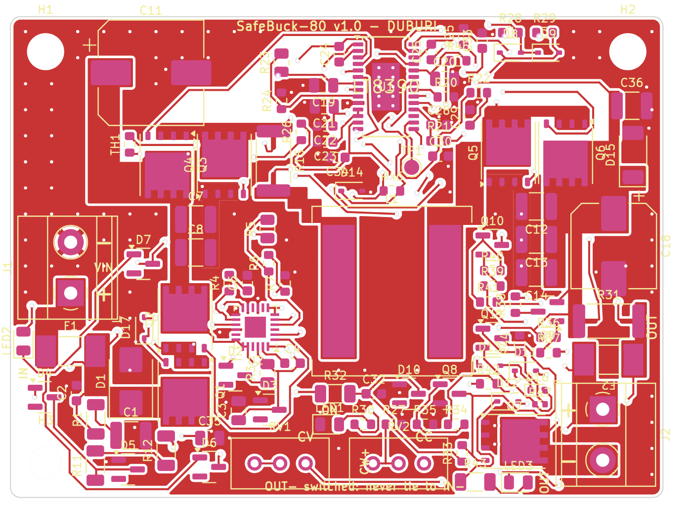
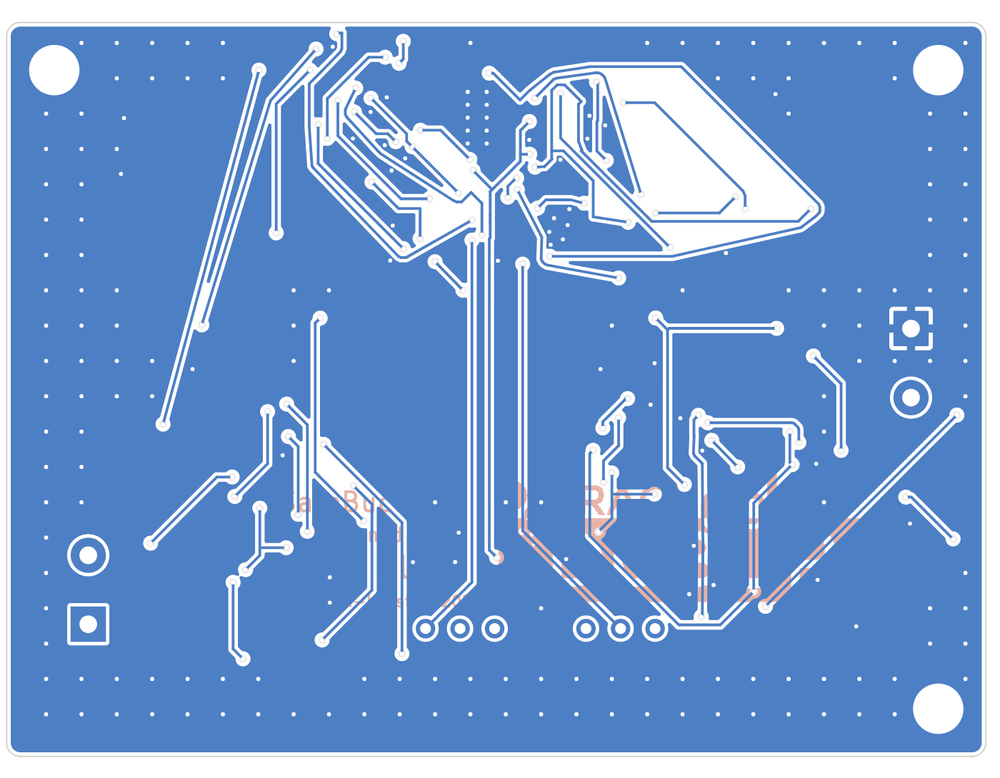

# SafeBuck-80 — 80 W protected buck-boost (LT8390 + LM74930)

**Banglay:** QS-1212CCBD (80 W automatic buck-boost) er moton ekta module (72 × 54 mm — QS-1212CCBD theke 7 × 6 mm boro, thanda thakar jonno), kintu
**4-switch synchronous buck-boost** (LT8390) diye — efficiency 93–97 % — ar **"smoke-tester" protection** shoho:
input ba output e vhul connection dile board purbe na, shudhu **red LED** jolbe. Puro design KiCad 7 e,
JLCPCB te sorasori order korar file shoho.

**English:** A 72 × 54 mm, 80 W, CV + CC buck-boost module, a little larger than the QS-1212CCBD (65 × 48 mm) for cooling. It uses a 4-switch
synchronous controller (LT8390) and full wrong-wiring protection: reversed input, over-voltage, under-voltage,
output short and a reversed battery on the output. Every one of these only lights a red LED.

| | |
|---|---|
| Input | 9–36 V (starts at 8.2 V, stops below 7.5 V), survives −60 V reversed and up to +60 V DC (cut-off above ~43 V, back on below ~39 V) |
| Output | 1.6–36 V (CV, 25-turn pot; the pot reaches ~39 V) and 0.94–8.33 A (CC, 25-turn pot), max 80 W |
| Topology | 4-switch synchronous buck-boost, 300 kHz ±15 % spread spectrum, peak-current mode |
| Efficiency (calculated) | 96.2–96.9 % (24 → 14.4 V, 80 W) · 93.4–94.8 % (9 → 35 V, 80 W) · 94.7–95.5 % (12 → 12 V) |
| Protection | reverse input to −60 V, OV cut-off ~43 V, UV 7.5 V, inrush limit, input short while running (Q1 gate clamp), output short (CC + 62.5 A instant trip), reversed battery on output (Q7 opens in 1–6 µs), battery above the CV setting (FB clamp), inductive loads (VOUT clamp diode), thermal foldback (PTC), last-resort fuses on both sides |
| Indicators | green = ON, red IN = input reversed / OV / UV, red OUT = battery reversed on the output |
| PCB | 72 × 54 mm (parts in a 65 × 48 mm area, the rest is GND copper for cooling), 2 layers, **2 oz copper**, 1.6 mm, all SMD on top (4 THT parts: 2 terminals, 2 pots), M3 holes in 3 corners |
| Board art | BRACU **Duburi** logo and "Designed by Jarif Alam" on the bottom silkscreen |

| Top (power stage + parts) | Bottom (GND plane, mirrored) |
|---|---|
|  |  |

> **Status / caveat:** the design is checked by calculation (`calc/design.py`: 57 checks, 56 pass, the one "fail" is the
> "bare-board rise above 45 °C at 80 W" note, now +46 °C), by netlist ↔ schematic ↔ PCB consistency checks (`hardware/verify.py`: all pass), by KiCad DRC
> (fully routed: 0 unconnected, 0 clearance, 0 dangling; the only DRC warnings are silkscreen overlaps and library-path notes) and by
> two rounds of independent review (the second round's 8 major findings are fixed or listed under Limitations). **It has not been built and measured yet.** Build one, follow the first-power-up steps in the build guide,
> and check the loop compensation with a load step before trusting it at 80 W.

---

## Documents (shuru korun ekhan theke)

| File | Ki ache |
|---|---|
| [`kicad/`](kicad/) | **KiCad project — open `kicad/SafeBuck-80.kicad_pro`** (schematic + routed PCB + project libraries). `kicad/SafeBuck-80_KiCad.zip` = same files in one download |
| [`docs/SafeBuck-80_Build_Guide.pdf`](docs/SafeBuck-80_Build_Guide.pdf) | **Noob-der jonno**: JLCPCB order step by step, first power-up, CV/CC set, protection test, troubleshooting |
| [`docs/SafeBuck-80_Component_Guide.pdf`](docs/SafeBuck-80_Component_Guide.pdf) | **Kon component keno**: every part's role, why it was chosen, full BOM with LCSC numbers |
| [`docs/SafeBuck-80_Schematic.pdf`](docs/SafeBuck-80_Schematic.pdf) | Full schematic (exported from KiCad) |
| [`docs/current_flow/index.html`](docs/current_flow/index.html) | **Current flow page**: 3D board, step-by-step current path (buck, boost, control, input ulta, output-e battery ulta, short), threshold-set-kora part-gulo formula shoho, shob part-er table. Folder download kore browser-e kholo (ba web server diye) |
| [`docs/layout-rules.md`](docs/layout-rules.md) | PCB layout rules used (hot loops, Kelvin sense, ground, thermal) |
| [`jlcpcb/ORDER_NOTES.md`](jlcpcb/ORDER_NOTES.md) | What to upload and which settings to pick at JLCPCB |

## JLCPCB te order (short version)

1. `jlcpcb/SafeBuck-80_gerbers.zip` upload. Settings: **2 layers, 1.6 mm, 2 oz outer copper**.
2. Turn on PCB Assembly (Standard, top side), then upload `jlcpcb/SafeBuck-80_BOM.csv` + `jlcpcb/SafeBuck-80_CPL.csv`.
3. Check the placement preview (pin-1 of U1/U2, FETs, diodes, LEDs, C11/C18 polarity) and order.
   Details are in [`jlcpcb/ORDER_NOTES.md`](jlcpcb/ORDER_NOTES.md).

## File chart — protita file ki kaj kore

| Path | Kaj (what it does) |
|---|---|
| `hardware/netlist.py` | **Single source of truth.** Every part: ref, value, footprint, MPN, LCSC number, role and pad → net map. Everything below is generated from this file |
| `hardware/placement.py` | Position/rotation of every part on the 72 × 54 mm board (hot-loop layout explained in the header) |
| `hardware/build_pcb.py` | Builds the custom LT8390 footprint, places all footprints, assigns nets, draws the outline, runs DRC → `kicad/SafeBuck-80_placed.kicad_pcb` |
| `hardware/route.py` | Power copper zones (union of rectangles, checked against foreign pads) → Specctra DSN (zones as fixed wires, net-tie keepouts) → Freerouting → imports the session → hand fan-out stubs at U2 → completion router → GND pours, stitching vias, GND pocket merge vias and hookups, dead-end cleanup, DRC → `kicad/SafeBuck-80.kicad_pcb` |
| `hardware/complete_routes.py` | Two-layer grid A* router (0.05 mm grid, 0.2 mm track, 0.205 mm gap) that finishes the connections Freerouting leaves open: rip-up with rollback, Kelvin net-tie entry, via keep-back at fine-pitch pins, string-pulled tracks |
| `hardware/make_schematic.py` | Generates the KiCad schematic `kicad/SafeBuck-80.kicad_sch` + project symbol library `SafeBuck.kicad_sym`; symbol UUIDs match the footprints |
| `hardware/make_jlcpcb.py` | Makes the JLCPCB package (Gerber + drill zip, BOM, CPL) |
| `hardware/make_logo.py` | Turns a logo image (`docs/img/duburi_logo.png`) into a silkscreen footprint for the board's bottom side; without an image it draws a "DUBURI" text badge |
| `hardware/verify.py` | One-command check: netlist ↔ schematic ↔ PCB, footprint links, DRC summary |
| `hardware/check_place.sh` | Quick placement check: build, list courtyard overlaps, SVG preview |
| `hardware/routing/SafeBuck-80_freerouting.ses` | The Freerouting session the routed board was built from (input of `route.py complete`) |
| `kicad/` | Copy of the KiCad project for opening/downloading (made by `make_jlcpcb.py`), plus a zip |
| `hardware/kicad/SafeBuck-80.kicad_pro` | KiCad project as generated by the scripts (same files as `kicad/`) |
| `hardware/kicad/SafeBuck-80.kicad_sch` | Schematic (label style: every pin has a net label) |
| `hardware/kicad/SafeBuck-80.kicad_pcb` | Routed 2-layer PCB |
| `hardware/kicad/SafeBuck.kicad_sym`, `SafeBuck.pretty/` | Project libraries: LT8390, LM74930, SOT-23 diode symbols; LT8390 FE28 footprint with 10 thermal vias |
| `hardware/kicad/sym-lib-table`, `fp-lib-table` | Point KiCad at the project libraries (loaded automatically) |
| `hardware/kicad/drc_routed.rpt` | KiCad DRC report of the routed board |
| `calc/design.py` | Every design equation from the datasheets: inductor, RSENSE, slope compensation, losses, ripple, UVLO/OV, inrush, LEDs, thermal, fault simulation of a reversed battery hit → `report.txt`, `results.json` |
| `calc/report.txt` | Human-readable result of all 57 checks |
| `docs/make_docs.py`, `docs/print_pdf.js`, `docs/src/*.html` | Build the PDF guides (edit the HTML, run the script) |
| `jlcpcb/` | Files to upload to JLCPCB |

Regenerate everything (Ubuntu with KiCad 7, Java, Node + Playwright):

```bash
cd hardware && python3 make_logo.py && /usr/bin/python3 build_pcb.py && /usr/bin/python3 route.py complete routing/SafeBuck-80_freerouting.ses && python3 make_schematic.py && /usr/bin/python3 verify.py && python3 make_jlcpcb.py && cd .. && python3 docs/make_docs.py
```

`routing/SafeBuck-80_freerouting.ses` is the Freerouting session this board was made from. `route.py route` runs
Freerouting from scratch instead; its result changes from run to run, so the completion step can end differently.

## Block diagram

```
J1 VIN+ ─ F1 15A ─┬─ D1 TVS        ┌──────── LT8390 4-switch buck-boost ────────┐
                  │                │  Q3 ┐            R15 3mΩ        ┌ Q6        │
                  └─ Q1 ─┬─ Q2 ──── VIN_P ─┤ SW1 ─[RSENSE]─ L1 10µH ─ SW2 ├─ VOUT_C ─ R31 12mΩ ─ F2 10A ─ J2 OUT+
             (HGATE)  CSRC (DGATE) │  Q4 ┘   (peak current)          └ Q5        │     (CC sense)
                     LM74930       └─────────────────────────────────────────────┘
             reverse/OV/UV, FLT→red IN                                    J2 OUT− ─ Q7 (100 V) ─ GND
                                                                 trips: Q9 (I>83 A), Q11 (OUT+<−1.85 V), hold: Q10, red OUT
```

## Fault matrix (vhul connection hole ki hoy)

| Wrong connection | What protects | Result |
|---|---|---|
| Input reversed (up to −60 V) | LM74930 + Q2 block, D1 is bidirectional | red IN LED, no current, nothing hot |
| Input 43–60 V DC | LM74930 OV opens Q1 (back on below 39.4 V; worst case ≥ 37.4 V, so a 36 V supply always restarts) | red IN LED, output off |
| Input shorted while running | D17 (15 V zener) clamps Q1's gate-source; Q2 blocks reverse current | output off, no damage |
| Input spike (hot-plug, cable inductance) | D1 SMBJ60CA, R1/C1 input RC damper, C11 ESR damping | clamped |
| Input below 7.5 V | LM74930 UV + LT8390 EN/UVLO | output off, red IN LED |
| Output short circuit | LT8390 CC limit (keep-running) + 62.5 A instant ISOC | runs at the CC current, recovers when the short is removed |
| Battery reversed on the output (≤ 35 V), any CV setting | Q9 (current > 83 A) or Q11 (OUT+ < −1.85 V) turns Q7 off within 1–6 µs, Q10 holds it off; D15 keeps VOUT_C above about −1.5 V | red OUT LED, peak 52–184 A for a few µs, Q7 avalanche ≤ 19 mJ (rated 274 mJ) |
| Battery (correct polarity) above the CV setting, e.g. 36 V battery at CV 1.6 V | R46 + D14 hold the FB pin below 5.4 V (6 V abs max); LT8390 stops switching (FB over-voltage) | no damage; the battery is not discharged when VIN is off |
| Inductive load (motor, solenoid) when the converter stops | D15 Schottky takes the freewheel current (OUT+ ≈ −1 V, Q11 trips only below −1.85 V) | no false trip, no avalanche |
| Battery on the output, correct polarity, input off | Q7 off without VIN | no drain (µA) |
| Overheating | PTC TH1 pulls CTRL down | current folds back at about 105 °C, stops at about 130 °C, auto-restarts |
| A MOSFET fails short | F1 / F2 | fuse opens (last resort only) |

**Never connect OUT− to VIN− outside the board (no common ground).** OUT− is switched by Q7. With a common ground the
converter still works, but (1) a battery reversed on the output is no longer blocked (F2 has to blow), and (2) if the
input is then also reversed, the supply is shorted through Q7's body diode. Use a floating load / separate supply,
which is how a bench "smoke tester" is normally wired.

## KiCad libraries used

| Library | Used for |
|---|---|
| `Device` (KiCad 7 standard) | R, C, C_Polarized, L, D, D_TVS, LED, Fuse, R_Potentiometer, Thermistor_PTC, Q_NPN_BEC, Q_PNP_BEC, NetTie_2 symbols |
| `Transistor_FET` | CSD18532Q5B, CSD19532Q5B symbols (TDSON-8 pinout: 1–3 S, 4 G, 5 D) |
| `Connector`, `Mechanical` | Screw_Terminal_01x02, TestPoint, MountingHole |
| `SafeBuck` (this project, `SafeBuck.kicad_sym`) | LT8390, LM74930, D_SOT23 (BAS21), DZ_SOT23 (BZX84) |
| Footprints: `Resistor_SMD`, `Capacitor_SMD`, `Diode_SMD`, `LED_SMD`, `Package_TO_SOT_SMD` (SOT-23, TDSON-8-1), `Package_DFN_QFN` (HVQFN-24 4×4), `Inductor_SMD` (L_Coilcraft_XAL1510-103), `Fuse` (Littelfuse NANO2 451/453), `Potentiometer_THT` (Bourns 3296W), `TerminalBlock_Phoenix` (MKDS 1,5/2-5,08), `TestPoint`, `MountingHole`, `NetTie` | Standard KiCad 7 footprints |
| `SafeBuck.pretty` (this project) | `LT8390_FE28_EB_TSSOP-28_EP4.75x2.74mm`: ADI FE28 (EB) land pattern with 2 × 5 thermal vias |

## Datasheets and sources I read

**Chosen parts**
- LT8390 (Analog Devices): https://www.analog.com/media/en/technical-documentation/data-sheets/LT8390.pdf
  (the copy I worked from was the public Chinese version hosted by LCSC: https://atta.szlcsc.com/upload/public/pdf/source/20221018/54D796C872281B2AD115D8A08B7AE0F6.pdf)
- LM74930-Q1 (TI): https://www.ti.com/lit/ds/symlink/lm74930-q1.pdf
- CSD18532Q5B (TI): https://www.ti.com/lit/ds/symlink/csd18532q5b.pdf
- CSD19532Q5B (TI): https://www.ti.com/lit/ds/symlink/csd19532q5b.pdf
- Coilcraft XAL1510: https://www.coilcraft.com/getmedia/cd1cef27-13f0-4568-8894-f7311475209b/xal1510.pdf
- Panasonic hybrid polymer ZA/ZC series (C18): https://na.industrial.panasonic.com/products/capacitors/polymer-capacitors/lineup/polymer-hybrid-aluminum-electrolytic-capacitor/series/79
- Panasonic EEE-FK1J101P (C11): https://www.digikey.ca/en/products/detail/panasonic-industry/EEE-FK1J101P/766195
- Murata GRM32EC72A106KE05L (10 µF 100 V): https://www.digikey.ca/en/products/detail/murata-electronics/GRM32EC72A106KE05L/7319245
- Murata PRF18 PTC: https://pim.murata.com/en-us/pim/details/?partNum=PRF18BC471QB5RB and spec https://pim.murata.com/asset/pim4/ptcForTemperatureSensor/SPEC_PRF18_471_PDF_PTCFORTEMPERATURESENSOR
- Littelfuse NANO² 451/453 fuses: https://www.littelfuse.com/products/fuses/surface-mount-fuses/nano-2-fuses/451_453.aspx
- Littelfuse SMBJ TVS: https://www.littelfuse.com/products/tvs-diodes/surface-mount/smbj.aspx

**Compared and rejected (why, in the component guide)**
- TI LM5176 https://www.ti.com/lit/ds/symlink/lm5176.pdf · LM5177 https://www.ti.com/lit/ds/symlink/lm5177.pdf (other buck-boost controllers)
- TI LM74502-Q1 https://www.ti.com/lit/ds/symlink/lm74502-q1.pdf · TPS1211-Q1 https://www.ti.com/lit/ds/symlink/tps1211-q1.pdf · LM74700-Q1 https://www.ti.com/lit/ds/symlink/lm74700-q1.pdf (other front-ends)
- TI CSD18540Q5B https://www.ti.com/lit/ds/symlink/csd18540q5b.pdf (best FET, but only 2 in stock at JLCPCB) · CSD18531Q5A https://www.ti.com/lit/ds/symlink/csd18531q5a.pdf · CSD18543Q3A https://www.ti.com/lit/ds/symlink/csd18543q3a.pdf · CSD19533Q5A https://www.ti.com/lit/ds/symlink/csd19533q5a.pdf
- Vishay SiR5607DP P-MOSFET https://www.vishay.com/docs/62247/sir5607dp.pdf (first output-switch idea; rejected: it runs in linear mode in a dead short)
- Bourns SRP1770TA https://www.bourns.com/docs/Product-Datasheets/SRP1770TA.pdf (first inductor choice; out of stock at JLCPCB)

**The original module**
- RoboticsBD QS-1212CCBD page: https://store.roboticsbd.com/power-module-adapter/4598-qs-1212ccbd-80w-automatic-buck-boost-power-supply-module-robotics-bangladesh.html
- QS-1224CBD (sibling) test/teardown with reverse-engineered schematic (UC3843A): https://chinese-electronics-products-tested.blogspot.com/p/qs-1224cbd-dc-dc-converter-tested.html
- Cirkit Designer QS-1212CCBD page: https://docs.cirkitdesigner.com/component/20a9b9bf-1da5-4816-b42f-8383cbccc88f/mdulo-qs-1212ccbd-80w-buck-boost
- JLCPCB parts library (stock and LCSC numbers, checked 2026-11-18): https://jlcpcb.com/parts

## Limitations (shotti kotha)

- **Not built yet.** The numbers come from datasheet equations and a simple fault model, not from measurements.
- **Loop compensation** (R22 10 k, C29 22 nF, C30 100 pF) is a calculated start value. Check it with a load step
  (for example 1 A → 6 A) on an oscilloscope, or in LTspice (the LT8390 model is free from ADI).
- **Switching loss** is an estimate (two models, about 1 % apart); real efficiency can be 1–2 % lower.
- **JLCPCB rotations**: the CPL applies the usual KiCad → JLC corrections (SOT-23, QFN, TSSOP, CP_Elec). Always check the
  placement preview.
- **Heat at 80 W:** the larger board (72 × 54 mm) brings the worst-case rise down from about +57 °C to about +46 °C above
  ambient (MOSFETs about 97 °C at 40 °C ambient, well below their 150 °C limit). At room temperature it runs 80 W without a
  heatsink. In a closed box, above about 40 °C ambient, or for hours at 80 W, screw a 40 × 40 mm heatsink under the board
  (then about +26 °C).
- The reversed-battery protection assumes a battery of 35 V or less (Q7 blocks VOUT + battery, up to about 75 V).
- **No input power limit.** The CC limit (up to 8.33 A) and the inductor peak limit allow more than 80 W at high output voltage
  (for example 36 V × 8 A). Set the CC pot so that VOUT × ICC ≤ 80 W. If you overload it anyway, the PTC folds the current
  back at about 105 °C and F1 (15 A) is the last resort.
- **Common ground** between input and output defeats the output reverse protection (see the warning above).
- In the highest-voltage reversed-battery cases (for example a 35 V battery at CV 35 V) Q7 turns off at up to ~180 A, above
  the 74 A that TI's avalanche graph is drawn to. The energy is small (≤ 19 mJ of a 274 mJ rating) and lasts < 2 µs, but it
  is outside the tested area of the datasheet.
- The LM74930 allows at most 85 V between its C and A pins. If the input is reversed to −60 V within seconds of running at
  more than about 26 V (input caps still charged), that limit is exceeded. Wait a few seconds, or keep the reverse voltage
  at or below −48 V.
- The NANO² fuses (F1, F2) break at most 50 A. They are a last resort against a failed MOSFET, not against a battery
  short.
- C18 carries about 2.2 A rms at the 9 V → 35 V, 80 W corner (rated 1.8 A at 105 °C, about 2.5 A at 85 °C). For long use at
  that corner, keep the board cool or stay at or below 65 W.
- **Ground around U1:** on two layers the signal tracks around the LT8390 cut the bottom GND plane into pockets. They are
  joined to the main GND by extra vias, and U1's exposed pad also connects through its 10 thermal vias and a top-layer
  link to pin 10, but this is not a solid plane under the IC. U1 loses up to about 1 W at 36 V in (INTVCC regulator).
  If it runs hot, add a heatsink pad under the board there, or move to a 4-layer board with an unbroken GND layer.
- One GND via (for C29, the compensation capacitor) touches the edge of C28's ground pad. Vias are tented, so very little
  solder is drawn into it, but check that C28 is soldered properly.
- **TG2 is still longer than ideal.** The gate track from U1 pin 25 to Q6 (switch D) is hand-routed (`route.FANOUT`): over the
  top of U1, along the top edge on the bottom layer, then in to Q6 from the right, 44 mm in all (Freerouting's was 64 mm and
  the first completed board's 97 mm, looping round the buck stage). The direct distance is 15 mm, but the parts right of U1
  leave no shorter way. BST2 is 9 mm for a 2 mm gap. Switch D only switches in boost mode (output above input).
- The PCB was laid out by scripts (Freerouting plus a custom completion router), not by hand. It passes DRC, but look
  over the copper in KiCad before you order, especially the hot loops (see `docs/layout-rules.md`).
